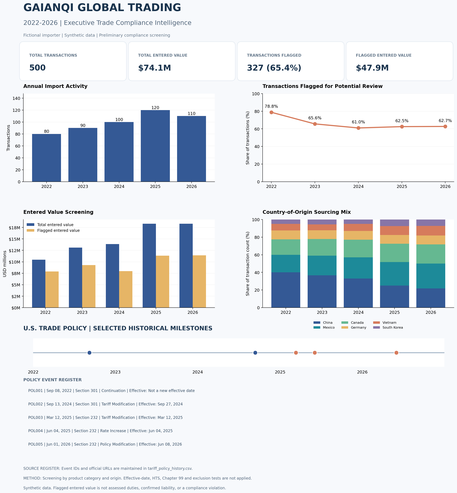

# Global Trade Data Analysis

GaiAnQi Global Trading is a fictional U.S. importer. All company transactions, sourcing patterns, and financial figures are synthetic.

## Project Overview

This project analyzes 500 simulated import transactions from 2022 through October 2026, combining transaction-level analytics with a historical U.S. trade policy reference.

The objective is to demonstrate how trade compliance and data analytics can work together to identify transactions requiring further review, evaluate sourcing patterns, and communicate potential financial exposure to business stakeholders.

## Executive Dashboard

The Executive Trade Compliance Intelligence Dashboard includes:

- Executive KPIs summarizing import activity and potential compliance review exposure
- Annual import transaction trends
- Transactions flagged for potential trade compliance review
- Entered-value screening analysis
- Country-of-origin sourcing diversification
- Selected historical U.S. tariff policy milestones from 2022–2026

## Key Findings

| Metric | Result |
|---|---|
| Import transactions analyzed | 500 |
| Total entered value | $74.1 million |
| Transactions flagged for potential review | 327 (65.4%) |
| Entered value associated with flagged transactions | $47.9 million |
| Analysis period | 2022–2026 |

### Sourcing Diversification

Within the synthetic dataset, China's share of import transactions declined from 40% in 2022 to 22% in 2026, while Mexico's share increased from 20% to 28%.

### Compliance Screening

The percentage of transactions flagged for potential review declined from 78.8% in 2022 to 62.7% in 2026.

However, the entered value associated with flagged transactions increased from approximately $7.9 million to $11.4 million, illustrating why compliance review workload and potential financial exposure should be evaluated separately.

These findings are scenario-based and do not represent actual company performance or confirmed tariff liabilities.

## U.S. Tariff Policy Context

The project maintains a historical policy reference covering selected developments under:

- **Section 301:** Trade measures affecting specified Chinese-origin products
- **Section 232:** Trade measures affecting covered steel and aluminum articles
- **Section 201:** Safeguard measures potentially relevant to certain solar products

The policy reference includes event dates, effective-date information, source agencies, official source URLs, and verification-status fields.

Historical policy events provide regulatory context but are not automatically applied as transaction-level tariff determinations.

## Technical Approach

**Tools:** Python, pandas, Matplotlib, CSV, GitHub

The workflow consists of:

1. Generating reproducible synthetic import transactions.
2. Maintaining structured product-to-policy screening references.
3. Screening transactions by product category and country of origin.
4. Aggregating annual transaction counts and entered values.
5. Visualizing sourcing trends and compliance screening results.
6. Integrating a data-driven historical tariff policy timeline.

## Data Governance & Compliance Limitations

This project is designed as an analytical demonstration, not a customs entry determination engine.

- HTS classifications are illustrative and require independent verification.
- Product-policy mappings identify potential review requirements, not confirmed tariff applicability.
- The screening process does not currently apply historical effective-date, Chapter 99, exclusion, or product-specific eligibility tests.
- Flagged entered value is not equivalent to assessed duties, confirmed tariff liability, or a compliance violation.
- Historical policy references are maintained separately from fictional importer data.
- Country-level historical market-context data, where used, is synthetic and should not be interpreted as official U.S. trade statistics.

## Professional Skills Demonstrated

**International Trade Compliance:** HTS awareness, country-of-origin screening, tariff program research, regulatory traceability, and compliance risk identification.

**Data Analytics:** Python automation, data validation, CSV processing, aggregation, and data visualization.

**Business Intelligence:** Executive KPI reporting, sourcing diversification analysis, financial exposure screening, and stakeholder communication.

**Data Governance:** Reproducible datasets, documented assumptions, source traceability, and clear separation of simulated data from regulatory references.

---

*This project is intended for educational and professional portfolio purposes. It does not constitute legal advice, a tariff classification ruling, or a calculation of actual customs duties.*
